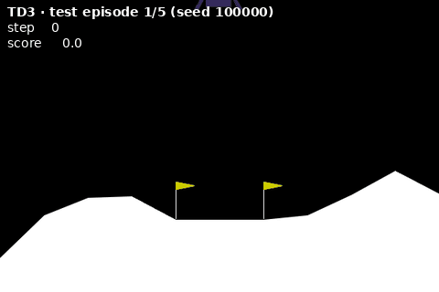
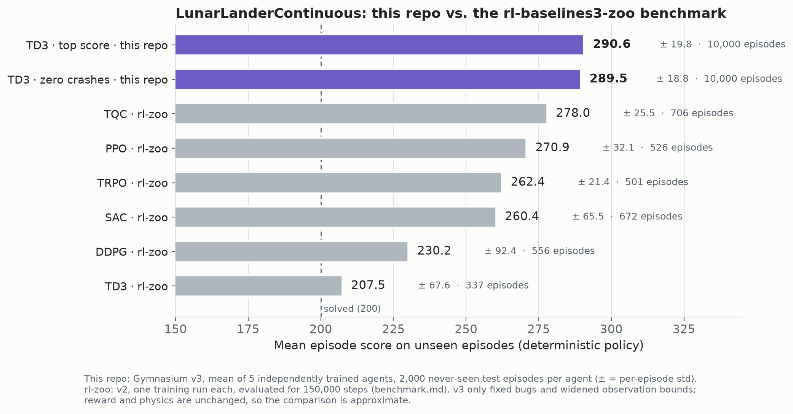
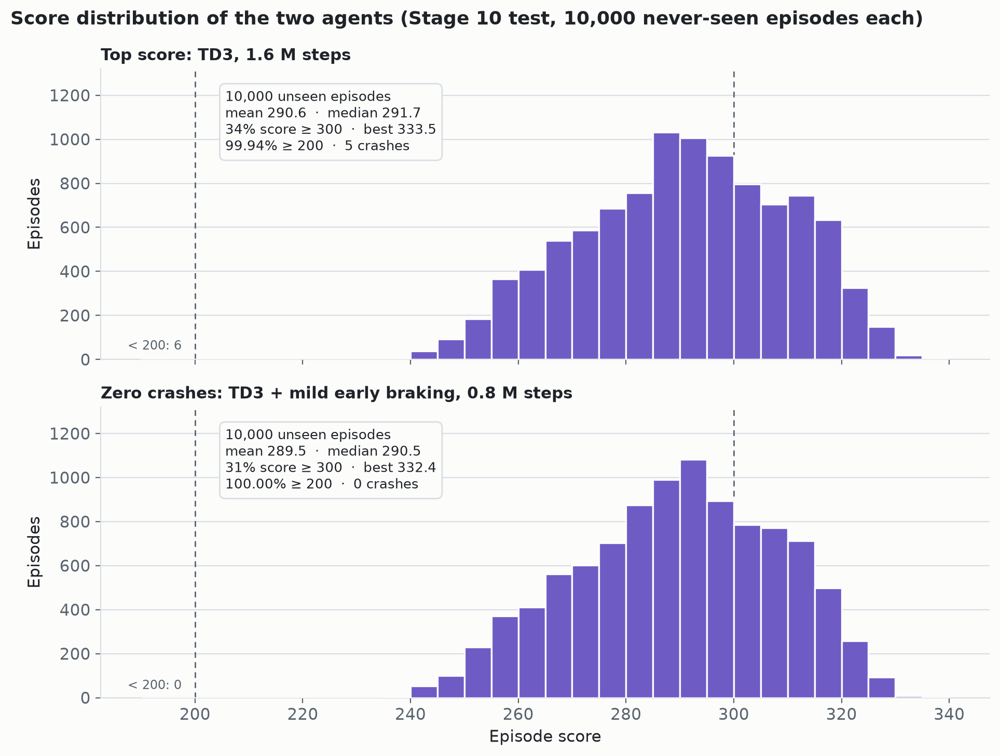
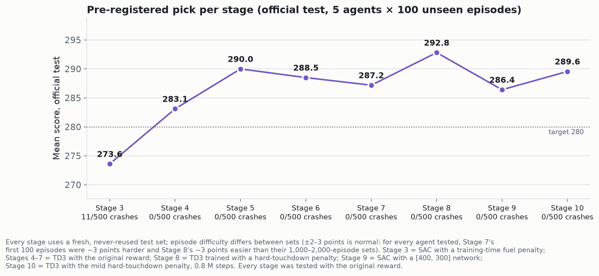

<div align="center">

# Lunar Lander TD3

### 290.6 over 10,000 never-seen episodes · a twin agent with 0 crashes in 40,000

**Deep-RL pilots for Gymnasium `LunarLanderContinuous`, trained on a 15 W laptop CPU and evaluated with selection rules
written down *before* every test.**


<table>
<tr>
<td align="center" width="50%"></td>
<td align="center" width="50%"></td>
</tr>
<tr>
<td align="center"><b>Top score</b> · TD3, 1.6 M steps<br>290.6 mean · 5 crashes in 10,000</td>
<td align="center"><b>Zero crashes</b> · TD3 + mild early braking, 0.8 M steps<br>289.5 mean · 0 crashes in 40,000</td>
</tr>
</table>

*Both agents on the same first five episodes of the newest test set, unfiltered. Top score: 291.2 · 259.4 · 325.3 · 278.6 · 246.6.
Zero crashes: 292.0 · 259.5 · 323.3 · 279.0 · 245.6.*

🇹🇷 **Türkçe:** [README_TR.md](README_TR.md)

</div>

## Highlights

- **Two agents, one trade-off.** On the same 10,000 never-seen episodes the **top scorer** averages **290.6** and
  crashed 5 times; its **zero-crash twin** averages **289.5**, never crashed, and its worst
  episode still scored 239. The gap is 1.1 points.
- **0 crashes in 40,000 independent validation and test episodes** for the zero-crash agent, over four separate
  evaluations in Stages 8 and 10. With 95 % confidence its true crash rate is below **0.0075 %** (exact binomial
  bound).
- **+13 over the best [rl-baselines3-zoo](https://github.com/DLR-RM/rl-baselines3-zoo/blob/master/benchmark.md)
  result** (TQC, 278.0), and the highest publicly verifiable mean we could find for this environment.
- **34 % of the top scorer's episodes score 300 or more**; best single episode **333.5**.
- **Stable across tests.** The top scorer's mean on three independent 10,000-episode tests (Stages 8, 9, 10):
  290.7 · 290.7 · 290.6. The zero-crash agent on two: 289.6 · 289.5.
- Original environment and reward at test time, deterministic policies, CPU only. Every number here is recomputed from
  raw per-episode logs by `python3 verify.py`, and any episode can be replayed from its seed.

> **Note on selection.** The pre-registered rule (fewest crashes on validation first, then the highest mean) picked
> the zero-crash agent; it is the default in `play.py` and `verify.py`. The top scorer is the highest mean of the 11
> Stage 10 candidates *on the test set*, so it is a post-hoc pick, but it was also the highest-scoring TD3 in the Stage 8
> and Stage 9 tests. Both are shown in full.



## Results

Stage 10 (final). Eleven candidates, five independently trained agents each, all tested once on the same never-seen
episodes. The seven trained for the full schedule are shown here; the four SAC checkpoints taken at 0.8 M steps
(means 229–280, 0–11 crashes) are in [`results/stage10_episodes.csv.gz`](results/stage10_episodes.csv.gz).

| Candidate (5 agents each) | Official test (5 × 100) | Crashes | Extended test (5 × 2,000) | Crashes | Below 200 | Worst episode | Validation crashes (10,000) |
|---|---:|---:|---:|---:|---:|---:|---:|
| TD3 + mild early-braking penalty† · 0.8 M steps — **zero crashes, pre-registered pick** | **289.6 ± 0.9** | **0** | **289.5 ± 0.7** | **0** | **0** | **238.8** | **0** |
| TD3, no penalty · 1.6 M steps — **top score** | **290.9 ± 0.4** | **0** | **290.6 ± 0.3** | **5** | **6** | **33.1** | **2** |
| TD3 + strong early-braking penalty† · 1.6 M steps (Stage 8 pick) | 290.0 ± 0.6 | 0 | 289.9 ± 0.6 | 0 | 1 | 185.4 | 0 |
| SAC + strong early-braking penalty† · 1.6 M steps (Stage 10 SAC pick) | 285.2 ± 2.7 | 0 | 285.0 ± 2.8 | 0 | 2 | 175.4 | 0 |
| SAC + mild early-braking penalty† · 1.6 M steps | 285.2 ± 3.7 | 0 | 285.2 ± 3.7 | 0 | 6 | 167.7 | 1 |
| SAC, low entropy, no penalty · 1.6 M steps (best SAC) | 286.3 ± 2.4 | 0 | 286.1 ± 2.3 | 0 | 0 | 213.8 | 1 |
| SAC, no penalty · 1.6 M steps (Stage 9 pick) | 285.5 ± 3.4 | 0 | 285.3 ± 3.4 | 0 | 0 | 231.5 | 1 |

± = 95 % confidence interval over the 5 agents. † Trained with an extra penalty for touching down too fast (strong:
100 × the excess over |v_y| = 0.25; mild: 50 × the excess over 0.30); **tested with the original reward**. Both
selection rules were fixed before training ([`docs/selection_rules.md`](docs/selection_rules.md), v8). Validation
crashes are counted on 90000–91999, the data the rule used.



## Crash safety

A crash (the lander's body hits the ground, −100 points) is the failure that matters most, and almost no published result
reports it. We counted every single one, in every stage:

| Stage | Headline agent (pre-registered rule) | Official test | Extended test |
|---|---|---:|---:|
| Stage 3 | SAC, training-time fuel penalty† | 11 / 500 | — |
| Stage 4 | TD3, [256, 256], 0.4 M steps | 0 / 500 | 2 / 5,000 |
| Stage 5 | TD3, [256, 256], 0.8 M steps | 0 / 500 | 1 / 5,000 |
| Stage 6 | TD3, no penalty · 0.8 M steps | 0 / 500 | 0 / 5,000 |
| Stage 7 | TD3, no penalty · 1.6 M steps | 0 / 500 | 2 / 5,000 |
| Stage 8 | TD3 + strong early-braking penalty† · 1.6 M steps | 0 / 500 | 1 / 10,000 |
| Stage 9 | SAC, no penalty · 1.6 M steps | 0 / 500 | 1 / 10,000 |
| Stage 10 | TD3 + mild early-braking penalty† · 0.8 M steps | 0 / 500 | 0 / 10,000 |

- **How rare:** the zero-crash agent has not crashed once in 40,000 never-seen episodes. The top scorer crashes
  about once in 2,000 episodes (8 · 3 · 5 crashes on the three 10,000-episode tests).
- **Why crashes happen:** all 34 TD3 crashes we replayed happened *on the landing pad*, a few steps after the legs
  touched down: 29 in Stages 6–8 (5–10 steps, both legs down in 28) and the top scorer's 5 in Stage 10 (5–9 steps,
  both legs down in all 5). In the 13 we measured in detail, the lander hit the ground about **twice as fast** as in a normal
  landing. High-scoring agents learn to brake as late as possible to save fuel, and on a few difficult starts the
  last-moment brake is not enough.
- **What fixed it:** training the same network with an extra penalty for hard touchdowns. The hardest 5 % of
  touchdowns slow down (0.40 → 0.34 for the mild penalty, 0.28 for the strong one), crashes vanish, and the cost is
  about one point.



## Why you can trust these numbers

- **A fresh test set for every stage, used once.** Training seeds 0–4; checkpoint selection and candidate ranking on
  separate validation episodes; test episodes 10000–10099, 20000–20999, …, 60000–61999, 80000–81999 and
  100000–101999, each retired after one use.
- **Pre-registered selection.** Every stage's rule was written down before its test, and from Stage 6 on (rule v4)
  before its training ([`docs/selection_rules.md`](docs/selection_rules.md)); the frozen Stage 10 decision is
  [`results/decision.json`](results/decision.json).
- **Raw data included.** All 220,000 Stage 10 validation and test episodes are in
  [`results/stage10_episodes.csv.gz`](results/stage10_episodes.csv.gz), the 120,000 of Stage 8 in
  [`results/stage8_episodes.csv.gz`](results/stage8_episodes.csv.gz); the raw logs of all 10 stages (about
  2,700 files) and the full development code are in [`data/all_stages.tar.gz`](data/all_stages.tar.gz).
- **One command to check.** `python3 verify.py` re-runs both selection rules on the validation data, recomputes every
  test number above, counts the zero-crash agent's 40,000 episodes and replays both agents on the official test
  episodes (scores match to ~1e-13).
- **Failures reported.** Variants that lost are in the tables; what did not work is explained in the FAQ below.

## What we learned (10 stages, about 232 hours of laptop wall-clock time)

- **TD3 beat SAC and PPO on safe, high-scoring landings.** With the rl-zoo settings SAC reached ≈ 268 and PPO ≈ 262;
  TD3 needed a lower learning rate (1e-3) and a longer random warm-up to train reliably, then became the best method.
- **SAC caught up only partly.** Given the same upgrades (bigger network, longer horizon, 1.6 M steps; Stages 9–10) SAC
  reached 286.1, about 4.5 points below TD3. It burns more fuel (≈ 24–26 points of fuel cost per episode vs. ≈ 21) and
  lands more slowly (≈ 180 steps vs. ≈ 156). One SAC agent kept hovering until about 1.2 M steps before it learned to
  land.
- **Bigger network + longer training = less fuel.** A [400, 300] network trained for 0.8–1.6 M steps lands faster, more
  centered and with ~20 % less fuel than our earlier [256, 256] agent, which is exactly what the reward pays for.
- **Score and safety pull against each other.** Braking late saves fuel but leaves no margin on hard starts. Penalizing
  hard touchdowns during training buys the safety back for about one point.
- **The ceiling is physical.** A perfect, fuel-free landing would average about 311 over random starts; the fuel needed
  just to stop the fall keeps a realistic mean near 290–300. Single episodes reach 330+ only on generous starts.

## FAQ

**What are the "official" and the "extended" test?** Each stage drew a fresh block of test episodes. The first 100 per
agent (5 × 100 = 500 episodes) are the *official* test, the size the original goal was defined on. The rest of the
block (up to 2,000 per agent, 10,000 in total) is the *extended* test; both were run at the same time, once. A
100-episode set can be 2–3 points easier or harder than average for every agent (Stage 8's was easier, Stage 7's
harder), so we lead with the 10,000.

**Why are the rl-zoo numbers lower?** The zoo trains each algorithm once, with general settings meant to *solve* the
task (≥ 200) on a modest budget (0.3–1 M steps), and reports that single run. Here one environment got all the
attention: tuned settings, a bigger network, up to 1.6 M steps, five agents per variant and a crash-aware choice of
checkpoint. The comparison shows what that focus buys; it does not mean the zoo's algorithms are worse.

**What do the episode counts next to the zoo results mean?** The zoo runs each trained agent for about 150,000
environment steps and averages the episodes that fit, so the count depends on how long its episodes last: 706 for TQC,
337 for TD3.

**What does "232 hours" mean?** Wall-clock time on one laptop, usually with 4–6 training or evaluation runs in
parallel (one CPU thread each). It covers all 10 stages, including the experiments that lost.

**Why did some ideas not work?**
- *Decaying the learning rate* (Stage 7): about one point lower; the crash difference (1 vs. 2) was within chance.
- *A training-time fuel penalty* (Stage 5): it saved fuel but crashed more (6 crashes on validation), so the rule
  did not pick it.
- *The big network at 0.4 M steps* (Stage 5) was simply under-trained: the same [400, 300] network trained for
  0.8–1.6 M steps became the best agent.
- *The early-braking penalty on SAC* (Stage 10): touchdowns became softer (0.34 → 0.24), but SAC was already not
  crashing on these episodes, so it cost about one point and bought nothing measurable.

## Installation

You need **Python 3.10–3.12** and about 1.5 GB of disk. **No GPU is needed**: everything here was trained and tested on a
laptop CPU. Box2D (the physics engine) is compiled during installation, so a C++ compiler must be present (one-time step
below). All package versions are pinned in [`requirements.txt`](requirements.txt).

```bash
git clone https://github.com/Aseloth99/lunar-lander-td3.git && cd lunar-lander-td3
```

Then pick your system (click a heading to open it):

<details open>
<summary><b>Windows</b> (PowerShell)</summary>

```powershell
# once: install "Microsoft C++ Build Tools" with the "Desktop development with C++" workload (needed to build Box2D)
py -3.12 -m venv .venv
.venv\Scripts\Activate.ps1
python -m pip install --upgrade pip swig
pip install -r requirements.txt
```

On Windows, write `python` instead of `python3` in the commands below.

</details>

<details>
<summary><b>Linux / WSL</b></summary>

```bash
sudo apt install python3-venv build-essential        # Ubuntu/Debian, once (other distros: venv module + gcc/g++)
python3 -m venv .venv && source .venv/bin/activate
pip install --upgrade pip swig
pip install -r requirements.txt --index-url https://download.pytorch.org/whl/cpu --extra-index-url https://pypi.org/simple
```

No sudo, no venv? `bash install.sh` installs everything into `./.pydeps` inside the project (delete the folder to uninstall).

</details>

<details>
<summary><b>macOS</b> (Apple Silicon, macOS 12 or newer)</summary>

```bash
xcode-select --install                               # C++ compiler, once
python3 -m venv .venv && source .venv/bin/activate
pip install --upgrade pip swig
pip install -r requirements.txt
```

</details>

Check the installation with `python3 check_env.py`.

**NVIDIA GPU (optional, training only).** Install the CUDA build of PyTorch instead,
`pip install -r requirements.txt --index-url https://download.pytorch.org/whl/cu121 --extra-index-url https://pypi.org/simple`,
and train with `--device cuda`. For networks this small a GPU brings little speed-up; evaluation and playback always run
on the CPU.

Tested end to end on Linux (WSL2, Ubuntu 24.04, Python 3.12) from a fresh clone. For Windows (x64) and macOS (Apple
Silicon, 12+) every pinned package except Box2D has a ready-made wheel (checked with pip); Box2D is compiled from
source. Intel Macs are not supported: PyTorch stopped publishing builds for them after version 2.2.

## Quick start

```bash
python3 play.py                               # watch the zero-crash agent land live (window; ESC to quit)
python3 play.py --group td3/v4big@1600k       # watch the top-scoring agent
python3 play.py --group sac/v9lowent@1600k    # watch the best SAC agent, for comparison
python3 verify.py                             # recompute every number and replay the official test episodes
python3 verify.py --fresh 200                 # ...and test both agents on 200 brand-new random episodes per agent
```

Replay a specific test episode, e.g. the top scorer's best one (333.5):
`python3 play.py --group td3/v4big@1600k --seed 0 --bolum 100898`.

Train the methods yourself (about 15 h per 1.6 M-step run on 4 CPU cores):
- top score: `python3 train.py --algo td3 --seed 0 --tag mine --config configs/td3_v4big.json`, then
  `python3 reselect.py --run-dir runs/td3/mine/seed0 --suffix 1600k --min-step 800000 --max-step 1600000`
- zero crashes: `python3 train.py --algo td3 --seed 0 --tag mine_soft --config configs/td3_v6soft.json`, then
  `python3 reselect.py --run-dir runs/td3/mine_soft/seed0 --suffix 800k --min-step 400000 --max-step 800000`

## Repository layout

| Path | Contents |
|---|---|
| `train.py`, `evaluate.py`, `reselect.py` | training, deterministic evaluation, crash-aware checkpoint selection |
| `play.py`, `make_video.py`, `verify.py` | watch an agent, render a video, verify the published numbers |
| `common.py`, `configs.py`, `configs/` | environment, seed sets, metrics; every configuration used |
| `runs/<algo>/<variant>/seed<k>/` | selected models (5 agents each): zero-crash (`td3/v6soft`, 0.8 M), top score (`td3/v4big`, 1.6 M), best SAC (`sac/v9lowent`, 1.6 M) |
| `results/` | frozen Stage 10 decision; all Stage 10 and Stage 8 validation/test episodes |
| `docs/` | pre-registered selection rules (v1–v8); the full 10-stage report in Turkish |
| `data/all_stages.tar.gz` | raw logs of all 10 stages and the full development code |
| `assets/` | the charts and videos on this page (English and Turkish) |

Code comments and console output are in Turkish (the project's working language).

## Hardware

AMD Ryzen 5 7520U (4 cores / 8 threads, 15 W), no GPU, ~7 GB RAM, Windows 10 + WSL2 Ubuntu 24.04, Python 3.12,
PyTorch 2.4.1 (CPU), Stable-Baselines3 2.4.1, Gymnasium 1.0.0.

## Author, license and citation

**Res. Asst. Mustafa Açık**, Department of Computer Engineering (Computer Hardware Division), Faculty of Engineering,
Karamanoğlu Mehmetbey University, Karaman, Türkiye · ORCID [0009-0000-6989-1268](https://orcid.org/0009-0000-6989-1268)

MIT © 2026 Mustafa Açık ([`LICENSE`](LICENSE)). To cite, use the "Cite this repository" button
([`CITATION.cff`](CITATION.cff)) or:

```bibtex
@software{acik_lunar_lander_td3_2026,
  author  = {Açık, Mustafa},
  title   = {Lunar Lander TD3: a crash-averse deep-RL agent for Gymnasium LunarLanderContinuous},
  year    = {2026},
  version = {1.0.0},
  url     = {https://github.com/Aseloth99/lunar-lander-td3},
  license = {MIT}
}
```
