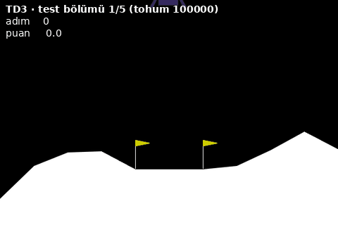
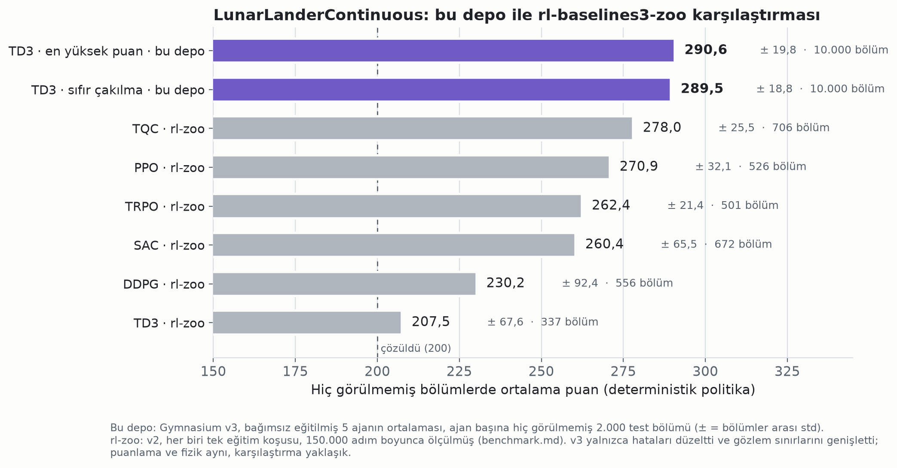
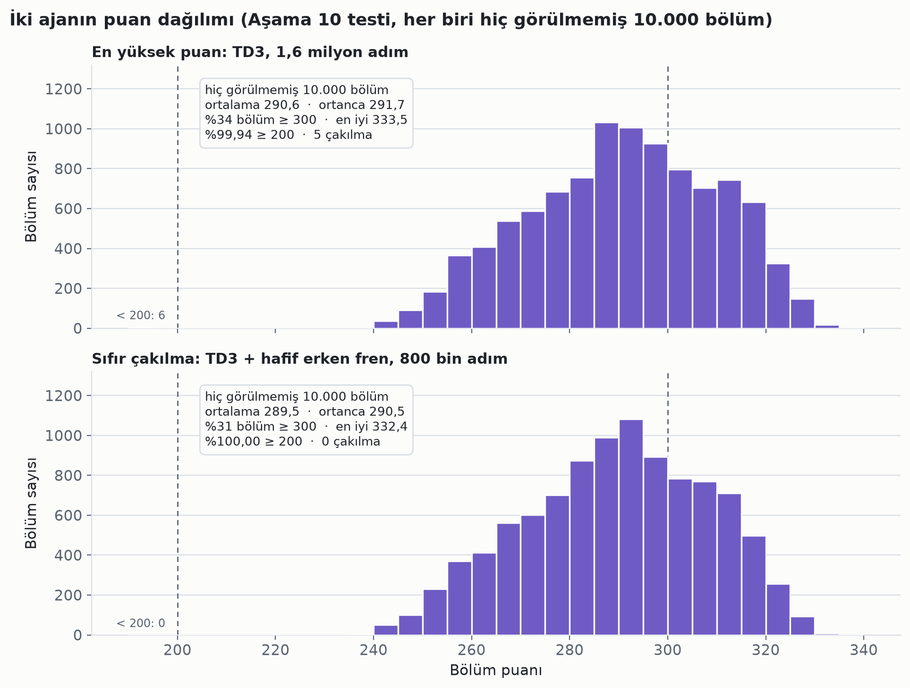
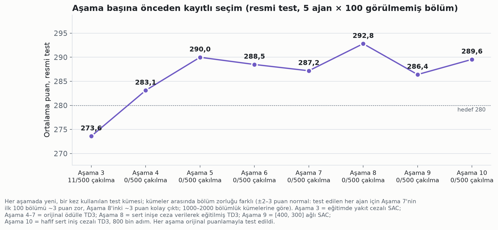

<div align="center">

# Lunar Lander TD3

### Hiç görülmemiş 10.000 bölümde 290,6 · ikiz ajan 40.000 bölümde 0 çakılma

**Gymnasium `LunarLanderContinuous` için derin pekiştirmeli öğrenme pilotları: 15 W'lık bir dizüstü işlemcisinde
eğitildi, her testten *önce* yazılmış seçim kurallarıyla değerlendirildi.**


<table>
<tr>
<td align="center" width="50%"></td>
<td align="center" width="50%"></td>
</tr>
<tr>
<td align="center"><b>En yüksek puan</b> · TD3, 1,6 milyon adım<br>ortalama 290,6 · 10.000 bölümde 5 çakılma</td>
<td align="center"><b>Hiç çakılmayan</b> · TD3 + hafif erken fren, 800 bin adım<br>ortalama 289,5 · 40.000 bölümde 0 çakılma</td>
</tr>
</table>

*İki ajan, en yeni test kümesinin aynı ilk beş bölümünde, ayıklanmadan. En yüksek puan: 291,2 · 259,4 · 325,3 · 278,6 · 246,6.
Hiç çakılmayan: 292,0 · 259,5 · 323,3 · 279,0 · 245,6.*

🇬🇧 **English:** [README.md](README.md) · 📖 **10 aşamanın tam raporu:** [docs/rapor_tr.md](docs/rapor_tr.md)

</div>

## Öne çıkanlar

- **İki ajan, bir takas.** Hiç görülmemiş aynı 10.000 bölümde **en yüksek puanlı** ajan ortalama **290,6** aldı
  ve 5 kez çakıldı. **İkizi** ortalama **289,5** aldı, hiç çakılmadı; en kötü bölümü bile
  239 puan. Aradaki fark 1,1 puan.
- **Hiç çakılmayan ajan, 40.000 bağımsız doğrulama ve test bölümünde 0 çakılma** verdi: Aşama 8 ve 10'daki dört
  ayrı ölçümün toplamı. Gerçek çakılma oranı %95 güvenle **%0,0075'in altında** (tam binom sınırı).
- [rl-baselines3-zoo](https://github.com/DLR-RM/rl-baselines3-zoo/blob/master/benchmark.md)'nun en iyi sonucunun (TQC,
  278,0) **+13 puan** üstünde. Bulabildiğimiz, herkese açık ve doğrulanabilir en yüksek ortalama.
- **En yüksek puanlı ajanın bölümlerinin %34'ü 300 ve üstü;** en iyi tek bölüm **333,5**.
- **Testten teste tutarlı.** En yüksek puanlı ajanın üç ayrı 10.000 bölümlük testteki (Aşama 8, 9, 10) ortalaması:
  290,7 · 290,7 · 290,6. Hiç çakılmayanınki iki testte: 289,6 · 289,5.
- **Değerlendirme koşulları:** Test, oyunun orijinal ortamı ve puanlamasıyla yapıldı. Politikalar deterministik,
  yalnızca CPU kullanıldı. Buradaki her sayı `python3 verify.py` ile ham bölüm kayıtlarından yeniden hesaplanabilir;
  her bölüm numarasıyla yeniden oynatılabilir.

> **Seçim notu.** Önceden yazılan kural (önce doğrulamada en az çakılma, sonra en yüksek ortalama) hiç çakılmayan ajanı
> seçti; `play.py` ve `verify.py` varsayılan olarak onu kullanır. En yüksek puanlı ajan, Aşama 10'un 11 adayı arasında
> *test kümesinde* ortalaması en yüksek olandır; yani sonradan seçilmiştir. Ama Aşama 8 ve Aşama 9 testlerinde de en
> yüksek puanlı TD3 oydu. İkisi de eksiksiz gösteriliyor.



## Sonuçlar

Aşama 10 (son aşama). On bir aday var, her biri bağımsız eğitilmiş beş ajandan oluşuyor. Hepsi aynı hiç görülmemiş
bölümlerde bir kez test edildi. Burada eğitimini tamamlayan yedi aday var. 800 bin adımda alınan dört SAC (ortalama
229–280, 0–11 çakılma) [`results/stage10_episodes.csv.gz`](results/stage10_episodes.csv.gz) içinde.

| Aday (her biri 5 ajan) | Resmi test (5 × 100) | Çakılma | Genişletilmiş test (5 × 2000) | Çakılma | 200 altı | En kötü bölüm | Doğrulamada çakılma (10 000) |
|---|---:|---:|---:|---:|---:|---:|---:|
| TD3 + hafif erken fren cezası† · 800 bin adım — **sıfır çakılma, kuralın seçimi** | **289,6 ± 0,9** | **0** | **289,5 ± 0,7** | **0** | **0** | **238,8** | **0** |
| TD3, cezasız · 1,6 milyon adım — **en yüksek puan** | **290,9 ± 0,4** | **0** | **290,6 ± 0,3** | **5** | **6** | **33,1** | **2** |
| TD3 + güçlü erken fren cezası† · 1,6 milyon adım (Aşama 8'in seçimi) | 290,0 ± 0,6 | 0 | 289,9 ± 0,6 | 0 | 1 | 185,4 | 0 |
| SAC + güçlü erken fren cezası† · 1,6 milyon adım (Aşama 10'un SAC seçimi) | 285,2 ± 2,7 | 0 | 285,0 ± 2,8 | 0 | 2 | 175,4 | 0 |
| SAC + hafif erken fren cezası† · 1,6 milyon adım | 285,2 ± 3,7 | 0 | 285,2 ± 3,7 | 0 | 6 | 167,7 | 1 |
| SAC, düşük entropi, cezasız · 1,6 milyon adım (en iyi SAC) | 286,3 ± 2,4 | 0 | 286,1 ± 2,3 | 0 | 0 | 213,8 | 1 |
| SAC, cezasız · 1,6 milyon adım (Aşama 9'un seçimi) | 285,5 ± 3,4 | 0 | 285,3 ± 3,4 | 0 | 0 | 231,5 | 1 |

± = 5 ajan üzerinden %95 güven aralığı.

† Eğitimde yere hızlı değmeye ek ceza verildi: güçlü cezada |v_y| = 0,25'i aşan kısmın 100 katı, hafif cezada 0,30'u
aşan kısmın 50 katı. **Test orijinal puanlamayla** yapıldı.

İki seçim kuralı da eğitimden önce yazıldı ([`docs/selection_rules.md`](docs/selection_rules.md), v8). Doğrulamadaki
çakılmalar, kuralın kullandığı 90000–91999 bölümlerinde sayıldı.



## Çakılma güvenliği

Çakılma (gövdenin yere çarpması, −100 puan) en önemli hatadır, ama yayımlanan sonuçların neredeyse hiçbiri onu
ölçmez. Biz her aşamada her birini saydık:

| Aşama | Ana ajan (önceden yazılmış kural) | Resmi test | Genişletilmiş test |
|---|---|---:|---:|
| Aşama 3 | SAC, eğitimde yakıt cezası† | 11 / 500 | — |
| Aşama 4 | TD3, [256, 256], 400 bin adım | 0 / 500 | 2 / 5.000 |
| Aşama 5 | TD3, [256, 256], 800 bin adım | 0 / 500 | 1 / 5.000 |
| Aşama 6 | TD3, cezasız · 800 bin adım | 0 / 500 | 0 / 5.000 |
| Aşama 7 | TD3, cezasız · 1,6 milyon adım | 0 / 500 | 2 / 5.000 |
| Aşama 8 | TD3 + güçlü erken fren cezası† · 1,6 milyon adım | 0 / 500 | 1 / 10.000 |
| Aşama 9 | SAC, cezasız · 1,6 milyon adım | 0 / 500 | 1 / 10.000 |
| Aşama 10 | TD3 + hafif erken fren cezası† · 800 bin adım | 0 / 500 | 0 / 10.000 |

- **Ne kadar nadir:** Hiç çakılmayan ajan, hiç görülmemiş 40.000 bölümde bir kez bile çakılmadı. En yüksek
  puanlı ajan yaklaşık 2000 bölümde bir çakılıyor (üç ayrı 10.000 bölümlük testte 8 · 3 · 5 çakılma).
- **Neden oluyor:** Yeniden oynattığımız 34 TD3 çakılmasının hepsi pistin üstünde, bacaklar yere değdikten birkaç adım
  sonra oldu: Aşama 6–8'de 29 (5–10 adım sonra; 28'inde iki bacak da yerde), Aşama 10'da en yüksek puanlı ajanın 5'i
  (5–9 adım sonra; hepsinde iki bacak da yerde). Ayrıntılı ölçtüğümüz 13 çakılmada araç, normal bir inişe göre yere
  yaklaşık **iki kat hızlı** değdi. Yüksek puanlı ajanlar yakıt tasarrufu için mümkün olan en son anda fren yapmayı
  öğreniyor. Birkaç zor başlangıçta da son an freni yetmiyor.
- **Ne düzeltti:** Aynı ağı sert inişe ek cezayla eğitmek. En sert %5'lik inişler yavaşlıyor (hafif cezada 0,40 → 0,34,
  güçlü cezada 0,28), çakılmalar kayboluyor. Bedeli yaklaşık 1 puan.



## Bu sayılara neden güvenebilirsiniz?

- **Her aşamada yeni, bir kez kullanılan test kümesi.** Eğitim tohumları 0–4. Kontrol noktası seçimi ve adayların
  sıralanması ayrı doğrulama bölümlerinde yapıldı. Test bölümleri 10000–10099, 20000–20999, …, 60000–61999,
  80000–81999 ve 100000–101999; her biri bir kez kullanıldı ve emekliye ayrıldı.
- **Önceden yazılmış seçim.** Her aşamanın kuralı o aşamanın testinden önce, Aşama 6'dan (kural v4) itibaren de
  eğitiminden önce yazıldı ([`docs/selection_rules.md`](docs/selection_rules.md)). Aşama 10'un dondurulmuş kararı:
  [`results/decision.json`](results/decision.json).
- **Ham veri depoda.** Aşama 10'un 220.000 doğrulama ve test bölümünün hepsi
  [`results/stage10_episodes.csv.gz`](results/stage10_episodes.csv.gz), Aşama 8'in 120.000 bölümü
  [`results/stage8_episodes.csv.gz`](results/stage8_episodes.csv.gz) içinde. 10 aşamanın bütün ham kayıtları (yaklaşık
  2.700 dosya) ve geliştirme kodunun tamamı [`data/all_stages.tar.gz`](data/all_stages.tar.gz) içinde.
- **Tek komutla kontrol.** `python3 verify.py` iki seçim kuralını doğrulama verisiyle yeniden çalıştırır, yukarıdaki
  bütün test sayılarını yeniden hesaplar, hiç çakılmayan ajanın 40.000 bölümünü sayar ve iki ajanı da resmi test
  bölümlerinde yeniden oynatır. Puanlar ~1e-13 farkla aynı çıkar.
- **Başarısızlıklar da yazılı.** Kaybeden çeşitler tablolarda; işe yaramayanların nedeni aşağıdaki SSS bölümünde.

## Ne öğrendik? (10 aşama, dizüstünde yaklaşık 232 saat)

- **Güvenli ve yüksek puanlı inişte TD3, SAC ve PPO'yu geçti.** rl-zoo ayarlarıyla SAC ≈ 268, PPO ≈ 262 aldı. TD3
  güvenilir eğitim için daha düşük öğrenme hızı (1e-3) ve daha uzun rastgele başlangıç istedi; sonra en iyi yöntem oldu.
- **SAC aradaki farkı ancak kısmen kapattı.** Aynı iyileştirmelerle (büyük ağ, daha uzağı gören hedef, 1,6 milyon adım;
  Aşama 9–10) SAC 286,1'e çıktı; TD3'ün yaklaşık 4,5 puan gerisinde. Daha çok yakıt yakıyor (bölüm başına yakıta giden
  ≈ 24–26 puan, TD3'te ≈ 21) ve daha yavaş iniyor (≈ 180 adım, TD3'te ≈ 156). Bir SAC ajanı inmeyi öğrenmeden önce
  ~1,2 milyon adıma kadar havada asılı kaldı.
- **Büyük ağ + uzun eğitim = daha az yakıt.** 0,8–1,6 milyon adım eğitilen [400, 300] ağ, önceki [256, 256] ajanımıza
  göre daha hızlı, daha merkezde ve ~%20 daha az yakıtla iniyor. Puanlama tam olarak bunu ödüllendiriyor.
- **Puan ile güvenlik birbirine ters çekiyor.** Geç fren yakıt kazandırır, ama zor başlangıçlarda hiç pay bırakmaz.
  Eğitimde sert inişi cezalandırmak güvenliği yaklaşık 1 puanlık bir bedelle geri getiriyor.
- **Tavan fiziksel.** Kusursuz ve yakıtsız bir iniş, rastgele başlangıçlarda ortalama ~311 getirirdi. Düşüşü
  durdurmaya yetecek yakıt bile gerçekçi ortalamayı 290–300 civarında tutuyor. Tek bölümler ancak "cömert"
  başlangıçlarda 330'u geçiyor.

## Sık sorulan sorular

**"Resmi" ve "genişletilmiş" test ne?** Her aşamada yeni bir test bölümü bloğu ayrıldı. Ajan başına ilk 100 bölüm
(5 × 100 = 500 bölüm) *resmi* testtir; ilk hedef bu büyüklükte tanımlanmıştı. Bloğun geri kalanı (ajan başına 2000'e
kadar, toplam 10.000) *genişletilmiş* testtir. İkisi aynı anda, bir kez çalıştırıldı. 100 bölümlük bir küme bütün
ajanlar için ortalamadan 2–3 puan kolay ya da zor çıkabiliyor (Aşama 8'inki kolay, Aşama 7'ninki zordu). Bu yüzden
öne 10.000 bölümlük sonucu koyuyoruz.

**rl-zoo sonuçları neden daha düşük?** zoo her algoritmayı bir kez, görevi *çözmeye* (≥ 200) yetecek genel ayarlarla ve
kısa bir bütçeyle (0,3–1 milyon adım) eğitip o tek koşuyu raporluyor. Burada bütün emek tek bir ortama verildi: ayarlar
bu ortam için seçildi, ağ büyütüldü, 1,6 milyon adıma kadar eğitildi, her çeşit için beş ajan eğitildi ve kontrol
noktası çakılmaya duyarlı bir kuralla seçildi. Karşılaştırma bu odaklanmanın ne kazandırdığını gösteriyor; zoo'daki
algoritmaların kötü olduğu anlamına gelmiyor.

**zoo sonuçlarının yanındaki bölüm sayıları ne?** zoo her eğitilmiş ajanı yaklaşık 150.000 adım boyunca çalıştırıp bu
sürede biten bölümlerin ortalamasını alıyor. Bu yüzden bölüm sayısı, bölümlerin ne kadar sürdüğüne bağlı: TQC'de 706,
TD3'te 337.

**"232 saat" ne demek?** Tek bir dizüstü bilgisayarda geçen gerçek süre (duvar saati); çoğu zaman 4–6 eğitim ya da
değerlendirme aynı anda çalıştı (her biri tek işlemci iş parçacığıyla). Kaybeden denemeler dahil 10 aşamanın hepsini
kapsıyor.

**Bazı fikirler neden işe yaramadı?**
- *Azalan öğrenme hızı* (Aşama 7): ortalama yaklaşık 1 puan düştü; çakılma farkı (1'e 2) şans sınırları içindeydi.
- *Eğitimde yakıt cezası* (Aşama 5): yakıt kazandırdı ama daha çok çakıldı (doğrulamada 6 çakılma); kural onu seçmedi.
- *0,4 milyon adımdaki büyük ağ* (Aşama 5) yalnızca yetersiz eğitilmişti: aynı [400, 300] ağ 0,8–1,6 milyon adım
  eğitilince en iyi ajan oldu.
- *SAC'ta erken fren cezası* (Aşama 10): inişler yumuşadı (0,34 → 0,24), ama SAC bu bölümlerde zaten çakılmıyordu.
  Yaklaşık 1 puana mal oldu, ölçülebilir bir kazanç getirmedi.

## Kurulum

Gerekenler: **Python 3.10–3.12** ve ~1,5 GB boş yer. **GPU gerekmez**: buradaki her şey bir dizüstü işlemcisinde
eğitildi ve test edildi. Box2D (fizik motoru) kurulum sırasında derlendiği için bir C++ derleyicisi gerekir (aşağıda
bir kerelik adım). Bütün paket sürümleri [`requirements.txt`](requirements.txt) içinde sabit.

```bash
git clone https://github.com/Aseloth99/lunar-lander-td3.git && cd lunar-lander-td3
```

Sonra sistemini seç (açmak için başlığa tıkla):

<details open>
<summary><b>Windows</b> (PowerShell)</summary>

```powershell
# bir kez: "Microsoft C++ Build Tools" kur, "Desktop development with C++" iş yükünü seç (Box2D derlemesi için)
py -3.12 -m venv .venv
.venv\Scripts\Activate.ps1
python -m pip install --upgrade pip swig
pip install -r requirements.txt
```

Windows'ta aşağıdaki komutlarda `python3` yerine `python` yaz.

</details>

<details>
<summary><b>Linux / WSL</b></summary>

```bash
sudo apt install python3-venv build-essential        # Ubuntu/Debian, bir kez (diğer dağıtımlar: venv modülü + gcc/g++)
python3 -m venv .venv && source .venv/bin/activate
pip install --upgrade pip swig
pip install -r requirements.txt --index-url https://download.pytorch.org/whl/cpu --extra-index-url https://pypi.org/simple
```

sudo ve venv yok mu? `bash install.sh` her şeyi proje klasöründeki `./.pydeps` içine kurar (kaldırmak için klasörü
silmek yeter).

</details>

<details>
<summary><b>macOS</b> (Apple Silicon, macOS 12 ya da daha yeni)</summary>

```bash
xcode-select --install                               # C++ derleyicisi, bir kez
python3 -m venv .venv && source .venv/bin/activate
pip install --upgrade pip swig
pip install -r requirements.txt
```

</details>

Kurulumu `python3 check_env.py` ile kontrol edebilirsin.

**NVIDIA GPU (isteğe bağlı, yalnızca eğitim için).** PyTorch'un CUDA sürümünü kur:
`pip install -r requirements.txt --index-url https://download.pytorch.org/whl/cu121 --extra-index-url https://pypi.org/simple`;
eğitimde `--device cuda` kullan. Bu kadar küçük ağlarda GPU pek hızlandırmaz. Değerlendirme ve izleme her zaman
işlemcide çalışır.

Linux'ta sıfırdan bir klonla baştan sona denendi (WSL2, Ubuntu 24.04, Python 3.12). Windows (x64) ve macOS (Apple
Silicon, 12+) için Box2D dışındaki her sabit paketin hazır kurulum dosyası (wheel) var (pip ile kontrol edildi); Box2D
kaynak koddan derlenir. Intel Mac desteklenmiyor: PyTorch, 2.2 sürümünden sonra Intel Mac için sürüm yayımlamıyor.

## Hızlı başlangıç

```bash
python3 play.py                               # hiç çakılmayan ajanı canlı izle (pencere; çıkmak için ESC)
python3 play.py --group td3/v4big@1600k       # en yüksek puanlı ajanı izle
python3 play.py --group sac/v9lowent@1600k    # karşılaştırma için en iyi SAC ajanını izle
python3 verify.py                             # bütün sayıları yeniden hesapla, resmi test bölümlerini yeniden oynat
python3 verify.py --fresh 200                 # ...ve iki ajanı da ajan başına 200 yepyeni bölümde test et
```

**Diğer örnekler:**
- **Belirli bir test bölümünü izlemek** (ör. en yüksek puanlı ajanın en iyi bölümü, 333,5):
  `python3 play.py --group td3/v4big@1600k --seed 0 --bolum 100898`
- **Yöntemleri kendin eğitmek** (4 CPU çekirdeğinde 1,6 milyon adımlık bir eğitim yaklaşık 15 saat):
  - en yüksek puan: `python3 train.py --algo td3 --seed 0 --tag benim --config configs/td3_v4big.json`, sonra
    `python3 reselect.py --run-dir runs/td3/benim/seed0 --suffix 1600k --min-step 800000 --max-step 1600000`
  - hiç çakılmayan: `python3 train.py --algo td3 --seed 0 --tag benim_hafif --config configs/td3_v6soft.json`, sonra
    `python3 reselect.py --run-dir runs/td3/benim_hafif/seed0 --suffix 800k --min-step 400000 --max-step 800000`

## Klasör düzeni

| Yol | İçerik |
|---|---|
| `train.py`, `evaluate.py`, `reselect.py` | eğitim, deterministik değerlendirme, çakılmaya duyarlı kontrol noktası seçimi |
| `play.py`, `make_video.py`, `verify.py` | ajanı izle, video üret, yayımlanan sayıları doğrula |
| `common.py`, `configs.py`, `configs/` | ortam, tohum kümeleri, ölçütler; kullanılan bütün ayarlar |
| `runs/<algo>/<çeşit>/seed<k>/` | seçilmiş modeller (her biri 5 ajan): hiç çakılmayan (`td3/v6soft`, 800 bin), en yüksek puanlı (`td3/v4big`, 1,6 milyon), en iyi SAC (`sac/v9lowent`, 1,6 milyon) |
| `results/` | Aşama 10'un dondurulmuş kararı; Aşama 10 ve Aşama 8'in bütün doğrulama/test bölümleri |
| `docs/` | önceden yazılmış seçim kuralları (v1–v8); 10 aşamanın tam Türkçe raporu |
| `data/all_stages.tar.gz` | 10 aşamanın bütün ham kayıtları ve geliştirme kodunun tamamı |
| `assets/` | bu sayfadaki grafikler ve videolar (İngilizce ve Türkçe) |

## Donanım

AMD Ryzen 5 7520U (4 çekirdek / 8 iş parçacığı, 15 W), GPU yok, ~7 GB RAM, Windows 10 + WSL2 Ubuntu 24.04, Python 3.12,
PyTorch 2.4.1 (CPU), Stable-Baselines3 2.4.1, Gymnasium 1.0.0.

## Yazar, lisans ve atıf

**Arş. Gör. Mustafa AÇIK**, Bilgisayar Mühendisliği Bölümü (Bilgisayar Donanımı ABD), Mühendislik Fakültesi,
Karamanoğlu Mehmetbey Üniversitesi, Karaman · ORCID [0009-0000-6989-1268](https://orcid.org/0009-0000-6989-1268)

MIT © 2026 Mustafa Açık ([`LICENSE`](LICENSE)). Atıf için "Cite this repository" düğmesi
([`CITATION.cff`](CITATION.cff)) ya da:

```bibtex
@software{acik_lunar_lander_td3_2026,
  author  = {Açık, Mustafa},
  title   = {Lunar Lander TD3: a crash-averse deep-RL agent for Gymnasium LunarLanderContinuous},
  year    = {2026},
  version = {1.0.0},
  url     = {https://github.com/Aseloth99/lunar-lander-td3},
  license = {MIT}
}
```
